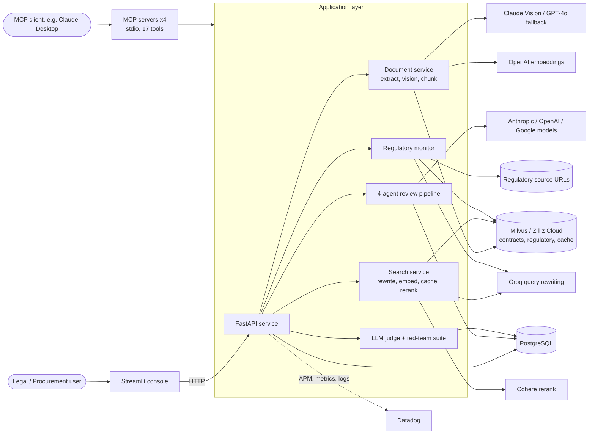

# Legal Contract Intelligence Platform

Multi-agent contract review, multimodal document understanding and regulatory change monitoring, exposed through a REST API, a Streamlit console and Model Context Protocol (MCP) tool servers.


-lightgrey)

## Overview

Commercial agreements routinely contain terms that are individually easy to miss and collectively expensive: a data-usage grant buried in a "service improvement" clause, a liability cap defined by a formula that resolves to a trivial amount, or an auto-renewal expressed as "continues in successive terms unless notice is given". Manual review is slow and inconsistent, and keyword search cannot reason about how clauses interact.

This platform ingests contracts (PDF, DOCX, TXT), indexes them for semantic retrieval, and runs a four-stage review pipeline in which each stage is handled by the model best suited to it. Findings are persisted, scored and surfaced as a structured report with prioritised negotiation points and suggested redlines. A separate monitoring workflow detects changes in configured regulatory sources and maps them to the contracts they are most likely to affect.

It is designed for legal-operations and procurement teams that need consistent first-pass review, and for engineering teams that want contract intelligence available as an API or as native tools inside an MCP client.

## Business Problem

- **Review capacity:** first-pass review of every vendor, SaaS and NDA agreement does not scale with headcount.
- **Hidden risk:** high-impact terms are frequently phrased unusually or split across clauses, schedules and exhibits.
- **Regulatory drift:** contracts signed under one regime can become non-compliant when guidance changes, and nothing connects a new circular to the agreements it touches.
- **Auditability:** AI-assisted review needs stored intermediate outputs, cost tracking and quality measurement before it can be trusted in a legal workflow.

## Solution

```text
Upload ──► Text extraction + page vision ──► Chunking + embeddings ──► Milvus
                                                                          │
Review request ──► Extractor ──► Risk Analyst ──► Comparator ──► Synthesis ──► PostgreSQL
                                                                          │
Regulatory sources ──► Change detection ──► Summary ──► Contract impact mapping
```

1. **Ingest.** PDFs are parsed with `unstructured` (layout-aware, table structure inferred) with a `pypdf` fallback; DOCX and TXT are parsed natively. For PDFs, each of the first 20 pages is rasterised and sent to a vision model to capture tables, signature blocks, stamps, handwriting and redlines that text extraction misses. Vision output is merged into the page's chunks.
2. **Index.** Chunks are embedded (OpenAI `text-embedding-3-small`) and stored in Milvus with cosine similarity.
3. **Review.** Four agents run in sequence and their outputs are stored individually for audit.
4. **Monitor.** Configured regulatory sources are fetched and content-hashed; changed sources are summarised, embedded, and matched against the contract library.
5. **Evaluate.** A custom four-dimension judge and a 50-contract adversarial suite measure review quality and drive prompt patches.

## Key Capabilities

| Capability | Implementation |
|---|---|
| Multi-provider agent pipeline | Extractor (Claude Sonnet), Risk Analyst (GPT-4o), Comparator (Gemini Pro), Synthesis (Claude Opus) in `backend/agents/contract_review_agent.py` |
| Multimodal document processing | Claude vision per PDF page with GPT-4o fallback, merged into text chunks |
| Retrieval | Query rewriting (Groq), embeddings (OpenAI), Milvus vector search, Cohere reranking |
| Semantic cache | Milvus-backed cache for library-wide searches (cosine threshold 0.92) |
| Regulatory monitoring | Content-hash change detection, LLM summaries, embedding-based mapping to contracts, severity heuristics |
| MCP integration | Four stdio MCP servers exposing 17 tools |
| Quality measurement | Four-dimension LLM judge and a 50-contract red-team suite with patch recommendations |
| Observability | Datadog APM, per-agent LLM spans, 70+ DogStatsD metrics, trace-correlated JSON logs, importable dashboard |
| Persistence | PostgreSQL via async SQLAlchemy with Alembic migrations |

## System Architecture



Deeper detail, including data flow and persistence: [docs/architecture.md](docs/architecture.md).

## AI Architecture

```text
Contract text (first 15,000 chars to extractor)
  → Extractor        clause segmentation and typing (JSON)
  → Risk Analyst     per-clause risk level, reasoning, matched patterns, exposure
                     (grounded in a 10-entry risk pattern library)
  → Comparator       deviations from the standard template for the contract type
  → Synthesis        overall score and level, top issues with redlines,
                     negotiation priorities, deal breakers, confidence
  → Persist          each stage output stored as JSON with token and model metadata
```

Design points:

- **Provider diversity by role.** Each stage uses a different model family, so the comparison and risk stages are independent of the extractor's output style.
- **Structured outputs.** Stages exchange JSON; parsing failures degrade to empty results with the raw output retained, and the pipeline continues.
- **Failure isolation.** A provider error in one stage is logged, counted as an error metric and recorded on its trace span without aborting the request.
- **Cost accounting.** Per-call token and cost figures are emitted per agent; the aggregate on the review record is an approximation (blended rate) and is labelled as such in code.

## Agent Architecture

| Agent | Model | Responsibility |
|---|---|---|
| Extractor | `claude-sonnet-4-5` | Identify and categorise clauses (liability, data rights, termination, governing law, indemnification, IP, confidentiality, payment, auto-renewal, SLA, warranty) |
| Risk Analyst | `gpt-4o` | Assign `low` / `medium` / `high` / `critical` with reasoning, using the risk pattern library |
| Comparator | `gemini-1.5-pro` | Compare clauses to `saas`, `nda` or `vendor` standard terms and recommend accept / negotiate / reject / seek legal review |
| Synthesis | `claude-opus-4-5` | Produce the executive report, prioritised issues, redline language and deal breakers |
| Regulatory summariser and impact assessor | Groq `llama3-8b-8192` | Summarise detected source changes and describe likely contract impact |
| Actionability judge | Groq `llama3-8b-8192` | Score specificity and clarity of review recommendations |

Agents are plain, sequential functions with explicit inputs and outputs rather than a conversational agent framework, which keeps the control flow, retries and per-stage observability straightforward.

## RAG Architecture

| Stage | Implementation |
|---|---|
| Ingestion | PDF via `unstructured` `hi_res` partitioning with title-based chunking; `pypdf` fallback; DOCX (paragraphs and tables) and TXT via paragraph-aware chunker |
| Chunking | 1,000 characters with 200 overlap (configurable) |
| Visual enrichment | Page images (150 dpi) analysed for tables, signatures, stamps, handwriting and redlines; text appended to the page's chunks |
| Embeddings | OpenAI `text-embedding-3-small`, 1,536 dimensions, batched |
| Vector store | Milvus (Zilliz Cloud), `AUTOINDEX`, cosine metric; collections for contracts, regulatory documents and semantic cache |
| Retrieval | Groq query rewrite, vector search at 2× `top_k` with optional contract filter, Cohere `rerank-english-v3.0` |
| Caching | Library-wide queries are served from the semantic cache above the 0.92 similarity threshold; contract-scoped queries bypass it |
| Grounding | Review stages operate on retrieved contract text; search results return the source contract, page and vision-enrichment flag |

## Technology Stack

| Layer | Technology |
|---|---|
| Frontend | Streamlit |
| Backend | FastAPI, Uvicorn, Pydantic v2, pydantic-settings |
| AI models | Anthropic Claude, OpenAI GPT-4o and embeddings, Google Gemini, Groq (Llama 3), Cohere rerank |
| Orchestration | Sequential agent pipeline in Python |
| RAG | `unstructured`, `pypdf`, `python-docx`, `pdf2image`, Milvus |
| Database | PostgreSQL, SQLAlchemy 2 (async, asyncpg), Alembic |
| Vector DB | Milvus on Zilliz Cloud (`pymilvus`) |
| Tool protocol | Model Context Protocol (`mcp`) |
| Infrastructure | Docker, Docker Compose, Render blueprint, GitHub Actions |
| Observability | Datadog (`ddtrace`, DogStatsD), `structlog` JSON logging |
| Testing | pytest, pytest-asyncio, pyflakes |

## Production Engineering

- **Modular layout:** API, agents, services, persistence, core (config, logging, metrics) and MCP servers are separate packages with one-directional dependencies.
- **Validated boundaries:** Pydantic request models; identifiers are parsed as UUIDs before they reach SQL or Milvus filter expressions; uploads are extension-checked and size-limited (default 25 MB).
- **Configuration:** all settings come from environment variables via `pydantic-settings`; managed-Postgres URL schemes and `sslmode` are normalised for asyncpg.
- **Error handling:** provider failures are contained per stage; upload and review failures return generic messages while details go to structured logs.
- **Migrations:** Alembic revision covering the full schema; the migration was rendered to SQL as part of validation.
- **Containers:** non-root images, API health check, Compose stack with an optional Datadog profile.
- **Tests:** 80 unit, API-validation and MCP handshake tests run in CI without provider keys.

## Security

- No secrets in the repository; `.env` is git-ignored and `.env.example` documents every variable.
- Input validation on identifiers and uploads; filter expressions are built only from parsed UUIDs.
- CORS origins are configurable (`CORS_ORIGINS`); credentialed CORS is only enabled with an explicit allow-list.
- LLM spans do not capture prompt or response text unless `DD_CAPTURE_LLM_CONTENT=true`.
- **Not included:** the API has no built-in authentication or authorisation. It is intended to run behind an authenticating gateway or private network. See [docs/security.md](docs/security.md).

## Deployment

| Target | How |
|---|---|
| Local containers | `docker compose up --build` (API, UI and PostgreSQL) |
| Local containers with Datadog | `docker compose --profile observability up --build` |
| Render | `render.yaml` blueprint for the API and a managed PostgreSQL instance |
| Bare process | `ddtrace-run uvicorn backend.api.main:app --host 0.0.0.0 --port 8000` |

Details, including migrations and MCP client configuration: [docs/deployment.md](docs/deployment.md).

## Local Development

```bash
git clone https://github.com/manobhisriram/Legal-Contract-Intelligence-Platform.git
cd Legal-Contract-Intelligence-Platform

bash scripts/setup.sh            # virtualenv, dependencies, .env template
# edit .env: provider keys, ZILLIZ_CLOUD_*, DATABASE_URL
source venv/bin/activate
alembic upgrade head             # apply migrations
bash scripts/dev.sh              # API on :8000, UI on :8501
```

- API: http://localhost:8000 (interactive docs at `/docs`)
- UI: http://localhost:8501

Running with Docker only:

```bash
cp .env.example .env             # set POSTGRES_PASSWORD, provider keys, Milvus credentials
docker compose up --build
```

## Environment Variables

`.env.example` lists every variable the code reads. Groups:

| Group | Variables |
|---|---|
| Application | `APP_ENV`, `APP_VERSION`, `LOG_LEVEL`, `CORS_ORIGINS`, `MAX_UPLOAD_MB`, `BACKEND_URL` |
| Model providers | `ANTHROPIC_API_KEY`, `OPENAI_API_KEY`, `GOOGLE_API_KEY`, `GROQ_API_KEY`, `COHERE_API_KEY` |
| Vector database | `ZILLIZ_CLOUD_URI`, `ZILLIZ_CLOUD_API_KEY` |
| PostgreSQL | `DATABASE_URL`, `DATABASE_URL_SYNC` (optional, derived), `POSTGRES_PASSWORD` (Compose only) |
| Datadog | `DD_API_KEY`, `DD_SITE`, `DD_SERVICE`, `DD_ENV`, `DD_AGENT_HOST`, `DD_AGENT_PORT`, `DD_DOGSTATSD_PORT`, `DD_TRACE_ENABLED`, `DD_CAPTURE_LLM_CONTENT` |
| Features | `ENABLE_VISION_PROCESSING`, `REGULATORY_SOURCES` |
| Tuning (optional) | `CHUNK_SIZE`, `CHUNK_OVERLAP`, `RETRIEVAL_TOP_K`, `RERANK_TOP_K`, `CACHE_SIMILARITY_THRESHOLD`, collection names |

## Testing

```bash
pip install -r requirements-dev.txt
python -m pytest tests
python -m pyflakes backend frontend tests alembic
```

The suite covers judge scoring, risk-pattern and red-team detection logic, red-team dataset integrity, configuration and database URL normalisation, document extraction for DOCX and TXT, metric helpers, Datadog fallbacks, API input validation, and a stdio handshake against each MCP server. Provider calls are mocked; end-to-end runs against live model providers and Milvus require real credentials and are not part of CI.

## Repository Structure

```text
.
├── backend/
│   ├── api/                  FastAPI application and routes
│   ├── agents/               review pipeline, regulatory agent, LLM judge, red-team suite
│   ├── services/             document processing, embeddings, reranking, query rewriting
│   ├── db/                   SQLAlchemy models and sessions, Milvus client
│   ├── mcp_servers/          four MCP servers (contracts, regulatory, search, risk)
│   ├── core/                 settings, logging, metrics, Datadog setup
│   └── utils/
├── frontend/                 Streamlit console
├── alembic/                  database migrations
├── infrastructure/
│   ├── docker/               backend and frontend Dockerfiles
│   └── observability/        Datadog dashboard definition
├── scripts/                  setup and development helpers
├── tests/
├── docs/                     architecture, deployment, security, development, evaluation
├── docker-compose.yml
├── render.yaml
└── requirements*.txt
```

## Engineering Notes

- **Evaluation is a framework, not a published result.** The repository contains the judge, ground-truth structures and adversarial suite; it does not ship benchmark scores. See [docs/evaluation.md](docs/evaluation.md) for what each component measures and its limits.
- **Contract retrieval for review** uses a metadata-filtered vector query capped at 50 chunks; very long contracts are truncated to that window before the extractor's 15,000-character limit.
- **Embedding failures** substitute zero vectors so a batch does not abort ingestion; such chunks will not be retrievable by similarity and failures are logged and counted.
- **Regulatory checks** run when `POST /api/regulatory/check` is called; scheduling is left to the deployment (cron, task scheduler). Severity assignment is keyword-based.
- **Governance records** exist in the schema (approve, reject, escalate) but are not yet exposed through API routes.
- **Pinned dependencies** were resolved together; `mcp` requires `pydantic>=2.8` and `starlette>=0.39`, which drives the FastAPI and pydantic versions.

## Disclaimer / Client Confidentiality

This repository was prepared for public technical review. It was developed in the context of an enterprise client engagement; client data, contracts, datasets, credentials and infrastructure details are not included, and any sample text in tests and the red-team suite is synthetic. Outputs of this system are decision-support material and do not constitute legal advice. See [LICENSE](LICENSE) for usage terms.
